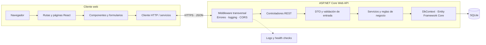
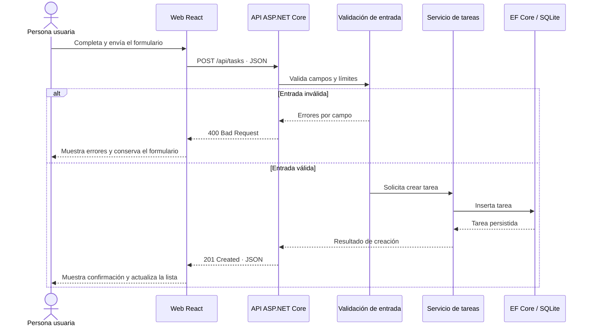
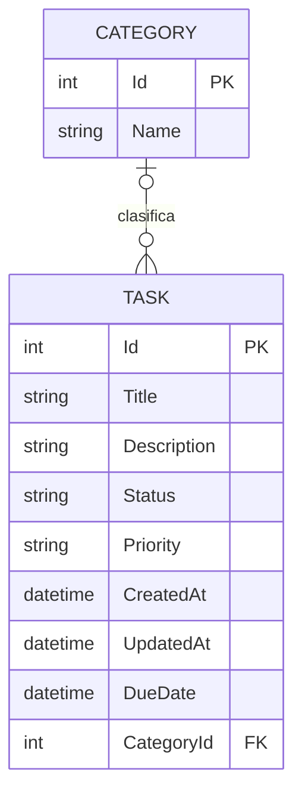

# Análisis completo de AppTodoList

> **Estado del documento:** especificación propuesta para orientar el desarrollo; no describe funcionalidades ya implementadas. El repositorio contiene actualmente documentación y laboratorios, no el producto ejecutable. Los requisitos con prioridad **MVP** son la línea base sugerida; las decisiones señaladas como pendientes deben confirmarse antes de cerrar contratos de producción.

## 1. Visión general

AppTodoList es una aplicación de gestión de tareas diseñada para evolucionar desde un MVP funcional hasta una solución preparada para producción, usando una arquitectura moderna basada en:

- ASP.NET Core 10 (API backend)
- React (frontend SPA)
- SQLite como base de datos local y de desarrollo
- Entity Framework Core para acceso a datos
- despliegue y observabilidad orientados a producción

La idea principal es entregar una herramienta simple y útil: crear, consultar, actualizar, completar y eliminar tareas de una única lista compartida. Este ejemplo no tiene cuentas ni autenticación; cualquier persona con acceso a la aplicación podrá ver y modificar todas las tareas.

La solución está pensada para crecer en fases:

1. MVP: gestión de tareas CRUD
2. Siguiente nivel: categorías, dashboard, notificaciones e informes
3. Producción: seguridad, monitorización, backups, despliegue automatizado, CI/CD

---

## 2. Objetivos del producto

### Objetivos de negocio

- Ayudar a usuarios a organizar tareas diarias y de trabajo
- Reducir la fricción de gestión de pendientes
- Ser usable tanto en entorno local como en producción
- Proporcionar una base sólida para extensibilidad

### Objetivos técnicos

- Arquitectura limpia y mantenible
- Separación clara entre frontend, API y capa de datos
- Uso de EF Core con SQLite para facilitar local development
- Seguridad por defecto y validación de entradas
- Preparación para despliegue con ambiente de desarrollo, staging y producción

---

## 3. Personas y escenarios de uso

### Usuario principal

- Persona individual o equipo pequeño
- Desea registrar tareas rápidas, marcar completadas y organizar prioridades

### Casos de uso

- Crear una tarea con título, descripción y prioridad
- Ver tareas pendientes y completadas
- Filtrar por estado, prioridad o texto
- Editar una tarea existente
- Eliminar tareas
- Ver estadísticas simples del progreso de la lista

### Escenarios de crecimiento

- varias listas para distintos contextos
- notificaciones por correo o dashboard
- sinergia con Angular/React/Next.js en frontend y API centralizada

---

## 4. Alcance funcional propuesto

### MVP

- CRUD de tareas
- Estado: pendiente, en progreso, completada
- Prioridad: baja, media, alta
- Búsqueda por texto
- Filtros por estado y prioridad
- Orden y paginación
- Fecha de vencimiento opcional
- Persistencia con SQLite

### Versión 1.1

- Etiquetas o categorías
- Dashboard de trabajo diario

### Versión 2.0

- Notificaciones
- API para integración externa
- Exportación e informes

---

## 5. Requisitos no funcionales

Los objetivos medibles, su método de verificación y sus supuestos se concretan en la sección 24. Esta sección resume las cualidades esperadas, no sustituye esos criterios.

### Rendimiento

- Carga rápida de listas de tareas
- Consultas optimizadas con índices en campos de filtro
- Objetivos de respuesta medibles y validados en un entorno de referencia
- Paginación para evitar grandes cargas

### Seguridad

- Validación de entrada en API y frontend
- Mitigación de XSS, CSRF e inyección SQL mediante defensas apropiadas en cada capa; el uso de EF Core por sí solo no garantiza la seguridad de toda la aplicación
- CORS configurado con restricciones
- Secrets gestionados fuera del código fuente

### Mantenibilidad

- Arquitectura por capas y separación de responsabilidades
- Repositorios o servicios como abstracción de acceso a datos
- Tests unitarios/integración para la lógica de negocio
- Migraciones automatizadas con EF Core

### Escalabilidad

- Soporte para más usuarios
- Respuesta a mayor volumen de datos sin reescritura estructural
- Preparación para migrar de SQLite a PostgreSQL/MySQL en producción

---

## 6. Arquitectura propuesta

### Arquitectura de alto nivel

Los siguientes diagramas describen la arquitectura objetivo propuesta para el MVP y su evolución; no implican que esos componentes estén implementados.

#### Diagrama de capas y componentes



La API valida los datos en el servidor. Esta aplicación no distingue personas ni ofrece privacidad individual: todas las operaciones trabajan sobre la misma lista.

#### Secuencia: crear una tarea



#### Modelo entidad-relación propuesto



La relación con `CATEGORY` es opcional para cada tarea y corresponde a V1.1 según el alcance propuesto. Las categorías, cuando se implementen, también pertenecerán a la única lista compartida.

### Capas sugeridas

#### 1. Frontend (React)

- Router (React Router)
- Componentes de UI: TaskList, TaskForm, Filters
- Gestor de estado: Context API o Zustand/Redux Toolkit
- Comunicación con backend mediante Axios o fetch

#### 2. Backend (ASP.NET Core 10 API)

- Controllers o endpoints REST
- Aplicación de lógica de negocio mediante servicios
- Validación con FluentValidation o DataAnnotations
- Middleware para logging, error handling, CORS y seguridad

#### 3. Persistencia (EF Core + SQLite)

- Mapeo ORM de entidades
- Migraciones versionadas
- Repositorios o DbContext centralizado
- Índices en campos comunes para rendimiento

---

## 7. Stack tecnológico recomendado

### Backend

- ASP.NET Core 10
- Entity Framework Core
- SQLite
- AutoMapper (si se desea un DTO-based layer)
- FluentValidation
- Serilog o ILogger con soporte estructurado

### Frontend

- React 18+
- Vite para configuración rápida de desarrollo
- TypeScript
- React Router
- Axios
- CSS Modules o Tailwind CSS

### DevOps y calidad

- Git
- GitHub Actions
- Docker
- ESLint y Prettier para frontend
- dotnet format / analyzers para backend
- xUnit o NUnit para tests

---

## 8. Modelo de datos propuesto

### Entidades clave

#### Tarea

- Id
- Title
- Description
- Status
- Priority
- CreatedAt
- UpdatedAt
- DueDate
- CategoryId (opcional)

#### Categoria

- Id
- Name

### Enumeraciones

#### Status

- Pending
- InProgress
- Completed

#### Priority

- Low
- Medium
- High

### Relaciones

- La aplicación mantiene una lista de tareas compartida.
- Una categoría puede agrupar muchas tareas; una tarea puede no tener categoría.

### Consideraciones para SQLite

- SQLite es una buena elección para desarrollo y despliegue ligero
- A nivel producción, conviene considerar PostgreSQL si se espera crecimiento real, concurrencia o herramientas más avanzadas
- Para empezar, SQLite funciona bien para un proyecto pequeño o de prueba de concepto

---

## 9. Diseño de la API REST

### Endpoints sugeridos

#### Tareas

- GET /api/tasks
- GET /api/tasks/{id}
- POST /api/tasks
- PUT /api/tasks/{id}
- DELETE /api/tasks/{id}
- PATCH /api/tasks/{id}/status

#### Categorías

- GET /api/categories
- POST /api/categories
- PUT /api/categories/{id}
- DELETE /api/categories/{id}

### Payloads

#### Crear tarea

```json
{
  "title": "Preparar demo",
  "description": "Revisar la lista de tareas y mostrar la demo final",
  "priority": "High",
  "status": "Pending",
  "dueDate": "2026-10-20T18:00:00"
}
```

---

## 10. Seguridad del sistema

Este ejemplo no implementará autenticación, cuentas ni autorización por persona. Las tareas no son privadas: cualquiera que pueda acceder a la aplicación o a la API puede consultar, crear, modificar y eliminar elementos de la lista compartida. No se deben almacenar datos sensibles ni publicar el servicio en una red no confiable sin añadir una protección externa apropiada.

### Requisitos mínimos

- HTTPS obligatorio en producción
- Validación de entrada en el servidor, límites de tamaño y consultas parametrizadas
- CORS limitado a los orígenes necesarios
- Cifrado de conexiones en entornos seguros
- Copias de seguridad del archivo SQLite en producción

### Mejores prácticas

- No guardar secretos en repositorio
- Usar `appsettings.Development.json` y `appsettings.Production.json` por entorno
- Configurar configuración con variables de entorno o Secret Manager
- Evitar exposición de stack traces en producción
- Usar middleware de manejo centralizado de excepciones

---

## 11. Frontend React: estructura sugerida

```text
src/
  app/
    App.tsx
    routes.tsx
  components/
    Tasks/
      TaskList.tsx
      TaskItem.tsx
      TaskForm.tsx
      FiltersBar.tsx
    Layout/
      Navbar.tsx
      Sidebar.tsx
  features/
    tasks/
      tasksApi.ts
      tasksSlice.ts
  pages/
    TaskListPage.tsx
  services/
    api.ts
  styles/
    globals.css
```

### Principios del frontend

- componentes reutilizables
- hooks para lógica de acceso a API
- manejo de errores con mensajes claros
- estados de carga y empty states
- UX con feedback inmediato

---

## 12. Persistencia con Entity Framework Core

### Ventajas para este proyecto

- Mapeo de entidades a tablas sin SQL manual
- Migraciones versionadas para cambios de esquema
- Menor riesgo de errores de SQL
- Facilidad para evolucionar el modelo con el tiempo

### Configuración recomendada

```csharp
public class AppDbContext : DbContext
{
    public DbSet<TaskItem> Tasks { get; set; }
    public DbSet<Category> Categories { get; set; }

    protected override void OnConfiguring(DbContextOptionsBuilder options)
        => options.UseSqlite("Data Source=app.db");
}
```

### Migraciones

- `Add-Migration InitialCreate`
- `Update-Database`
- Versionado del esquema en Git

### Consideraciones

- Índices sobre `Status`, `Priority`, `DueDate` según las consultas reales
- Uso de `AsNoTracking` para consultas de solo lectura
- Comportamiento explícito en transacciones para consistencia

---

## 13. Pruebas recomendadas

El plan ejecutable y los casos de aceptación identificados están en la sección 27.

### Pruebas backend

- Unit tests para servicios de negocio
- Integration tests para endpoints API
- Validación de DTOs y errores de dominio

### Pruebas frontend

- Component tests para formularios y filtros
- Tests de integración para creación, consulta y edición de tareas
- Coverage mínimo en lógica crítica

### Herramientas sugeridas

- xUnit / NUnit para backend
- React Testing Library para frontend
- Playwright para e2e

---

## 14. Observabilidad y operativa

### Logs

- Logs estructurados con niveles: Information, Warning, Error
- IDs de solicitud para trazabilidad
- Registro de errores con contexto de la solicitud y el endpoint, sin datos sensibles

### Monitoring

- Health checks de API y base de datos
- Métricas de rendimiento y latencia
- Alerts para errores y tiempo de respuesta

### Health checks sugeridos

- `/health`
- `/healthz`
- verificación de base de datos y dependencias

---

## 15. CI/CD para producción

### Pipeline recomendado

#### Build

- restaurar dependencias
- compilar backend y frontend
- ejecutar tests
- validar linting

#### Validate

- análisis estático
- pruebas de integración
- revisión de seguridad

#### Deploy

- ambiente de desarrollo automático
- ambiente de staging con pruebas manuales
- producción con push seguro y revisión previa

### GitHub Actions sugerido

- `build.yml`
- `test.yml`
- `deploy-dev.yml`
- `deploy-prod.yml`

---

## 16. Preparación para producción

### Seguridad

- HTTPS obligatorio
- higiene de secretos y no compartir archivos `.env` en el repo
- CORS restringido
- validación de entradas y configuración segura de errores

### Confiabilidad

- backups de la base de datos
- pruebas de recuperación ante caída rápida
- politicas de logs y retención

### Escalabilidad

- separar frontend y backend en despliegues distintos si crece
- usar CDN o reverse proxy para frontend
- considerar PostgreSQL en producción si se espera mucha concurrencia
- introducir caché cuando el volumen lo requiera

---

## 17. Roadmap recomendado de implementación

### Fase 1: base funcional

- proyecto ASP.NET Core + React
- conexión con SQLite
- migración inicial
- CRUD de tareas con estado, prioridad y fecha de vencimiento opcional
- búsqueda, filtros, orden y paginación
- sin cuentas ni autenticación; lista compartida

### Fase 2: UX y usabilidad

- categorías compartidas
- dashboard del progreso

### Fase 3: confiabilidad

- tests e2e
- UI con feedback de errores
- logs mejorados
- health checks

### Fase 4: producción

- entorno seguro y automatizado
- deployment pipeline
- backups
- observabilidad centralizada

---

## 18. Recomendación final de arquitectura

Para este caso, la mejor opción inicial es:

- ASP.NET Core 10 para la API
- React + TypeScript para el frontend
- SQLite con EF Core para el primer ciclo de vida
- arquitectura modular y servicios bien definidos

Esto permite construir rápido, sin perder capacidad de crecimiento. El punto crítico es no cerrar el sistema a SQLite desde el inicio: si la aplicación escala, la capa de datos y el diseño de servicios deben permitir migrar a PostgreSQL o SQL Server sin cambiar completamente la lógica del negocio.

---

## 19. Conclusión

AppTodoList tiene un excelente punto de partida para convertirse en un producto útil, seguro y escalable. La decisión de combinar ASP.NET Core 10 con React y SQLite ofrece un equilibrio ideal entre velocidad de desarrollo, claridad de arquitectura y capacidad de crecimiento.

La clave del éxito estará en:

- diseñar una API limpia y segura
- mantener la base de datos versionada con EF Core
- preparar la solución para un despliegue profesional
- construir con tests y observabilidad desde el principio

Este enfoque permite que AppTodoList pase de un prototipo funcional a una aplicación de nivel productivo sin necesidad de rehacer la base del proyecto.

---

## 20. Estructura recomendada del proyecto

```text
AppTodoList/
├── src/
│   ├── AppTodoList.Api/
│   │   ├── Controllers/
│   │   ├── Data/
│   │   ├── Models/
│   │   ├── Services/
│   │   ├── DTOs/
│   │   ├── Configuration/
│   │   ├── Program.cs
│   │   └── appsettings*.json
│   ├── AppTodoList.Web/
│   │   ├── src/
│   │   ├── public/
│   │   ├── package.json
│   │   └── vite.config.ts
│   └── tests/
│       ├── AppTodoList.Api.Tests/
│       └── AppTodoList.Web.Tests/
├── docs/
├── .github/workflows/
├── Dockerfile
├── README.md
└── .gitignore
```

Este tipo de estructura facilita la evolución del producto y reduce la complejidad del mantenimiento a medio plazo.

---

## 21. Convenciones de especificación y priorización

- **MVP:** requisito necesario para la primera versión utilizable.
- **V1.1:** mejora posterior al MVP; no bloquea su aceptación.
- **Futuro:** idea de evolución sin compromiso de fecha.
- **Must / Should / Could:** prioridad alta, media y deseable, respectivamente.
- Los requisitos de este análisis son objetivos de producto propuestos. Si una decisión de seguridad, privacidad o contrato queda abierta, debe resolverse antes de publicar la versión correspondiente.
- Los códigos RF, RNF, HU y CP se mantienen estables para poder vincular requisitos, historias y pruebas.

## 22. Requisitos funcionales

El sistema gestiona una única lista compartida. No hay cuentas, inicio de sesión ni datos asociados a una persona concreta.

| ID | Prioridad | Requisito |
|---|---|---|
| RF-01 | MVP / Must | La persona usuaria podrá crear una tarea con título obligatorio y, opcionalmente, descripción, prioridad y fecha de vencimiento. El servidor asignará las fechas de creación y actualización. |
| RF-02 | MVP / Must | Si no se especifican, el estado inicial será **Pendiente** y la prioridad inicial será **Media**. |
| RF-03 | MVP / Must | La persona usuaria podrá consultar la lista compartida. La lista mostrará como mínimo título, estado, prioridad y fecha de vencimiento cuando exista. |
| RF-04 | MVP / Must | La persona usuaria podrá consultar el detalle de una tarea existente. |
| RF-05 | MVP / Must | La persona usuaria podrá editar título, descripción, prioridad y vencimiento. La edición actualizará `UpdatedAt` y no cambiará `CreatedAt`. |
| RF-06 | MVP / Must | La persona usuaria podrá cambiar el estado entre Pendiente, En progreso y Completada. La acción será idempotente: repetir el mismo cambio no generará un estado distinto. |
| RF-07 | MVP / Must | La persona usuaria podrá eliminar una tarea. La interfaz pedirá confirmación antes de una eliminación irreversible. |
| RF-08 | MVP / Must | La persona usuaria podrá buscar por texto en el título y la descripción, sin distinguir mayúsculas de minúsculas. |
| RF-09 | MVP / Must | La persona usuaria podrá filtrar la lista por estado y prioridad, y combinar los filtros con la búsqueda. |
| RF-10 | MVP / Must | La persona usuaria podrá ordenar las tareas por fecha de creación, vencimiento, prioridad o estado. El orden por defecto será fecha de creación descendente; los empates tendrán un criterio estable. |
| RF-11 | MVP / Must | El listado tendrá paginación o límite de resultados aplicado en el servidor. El tamaño máximo de página propuesto es 100; el cliente no podrá solicitar una página ilimitada. |
| RF-12 | MVP / Must | La interfaz mostrará estados diferenciados de carga, lista vacía, error y operación completada, y ofrecerá una acción de reintento cuando sea pertinente. |
| RF-13 | V1.1 / Should | La persona usuaria podrá filtrar por rango de vencimiento y consultar tareas vencidas. Una tarea vencida se define como no completada con vencimiento anterior a la fecha y hora actuales. |
| RF-14 | V1.1 / Should | La persona usuaria podrá crear y administrar categorías compartidas y asignarlas a tareas. |
| RF-15 | V1.1 / Should | La persona usuaria podrá consultar un resumen de tareas pendientes, en progreso, completadas y vencidas dentro de un período definido. |

### 22.3 Contrato HTTP propuesto

Se conservan las rutas REST orientativas de la sección 9. Como comportamiento de referencia:

- `GET /api/tasks` admite búsqueda, filtros, orden y paginación sobre la lista compartida.
- Las operaciones de creación, edición, cambio de estado y eliminación responden con errores coherentes: `400` para entrada inválida y `404` para una tarea inexistente.
- La creación satisfactoria devuelve `201 Created`; la consulta satisfactoria devuelve `200 OK`; la eliminación satisfactoria devuelve `204 No Content`.
- Los errores devuelven una estructura JSON estable, sin trazas internas ni datos sensibles. El formato concreto de paginación y errores se documentará en OpenAPI antes de estabilizar la API.
- Las rutas de categorías sólo se incorporan a la API cuando se implemente RF-14.

## 23. Reglas de negocio y validación

1. La aplicación mantiene una única lista compartida; las tareas no tienen propietario ni visibilidad individual.
2. Valores válidos de estado: **Pendiente**, **En progreso** y **Completada**. Valores válidos de prioridad: **Baja**, **Media** y **Alta**. La API rechazará valores desconocidos.
3. El título se recortará de espacios exteriores y será obligatorio. Longitud propuesta: entre 1 y 200 caracteres.
4. La descripción será opcional; longitud máxima propuesta: 2.000 caracteres.
5. La fecha de vencimiento será opcional. Se aceptarán vencimientos pasados para poder registrar tareas atrasadas. Las fechas se almacenarán de forma consistente en UTC y se presentarán según la zona horaria local del dispositivo.
6. El servidor validará toda entrada aunque el cliente ya la haya validado. Los mensajes de validación identificarán el campo y no incluirán valores secretos.
7. `CreatedAt` y `UpdatedAt` serán generados por el servidor y no podrán modificarse mediante campos enviados por el cliente.
8. Buscar, ordenar, filtrar y paginar se ejecutará sobre la lista compartida en el servidor.
9. El borrado de una tarea será definitivo en el MVP. Si se decide incorporar papelera o recuperación, se especificará como cambio funcional separado.
10. Las categorías, cuando se implementen, también serán compartidas por toda la aplicación.

Los límites de longitud y el orden por defecto anteriores son valores iniciales propuestos; deben confirmarse al aprobar el MVP y mantenerse iguales en validación, API y formulario.

## 24. Requisitos no funcionales verificables

| ID | Prioridad | Requisito / objetivo | Verificación |
|---|---|---|---|
| RNF-01 | MVP / Must | **Rendimiento API:** bajo la configuración de referencia, el percentil 95 de consulta paginada de tareas será ≤ 500 ms con 50 solicitudes concurrentes, hasta 10.000 tareas en la lista y una página de hasta 50 elementos. | Prueba de carga en staging; registrar hardware, versión, tamaño de datos y resultado. No incluye latencia de red pública. |
| RNF-02 | MVP / Must | **Interfaz:** el contenido principal de la lista será utilizable en ≤ 2,5 s en el perfil de dispositivo y red de referencia documentado para la prueba. | Medición de LCP con herramienta automatizada en la compilación de producción. |
| RNF-03 | MVP / Must | **Alcance de acceso:** toda persona con acceso de red a la aplicación podrá consultar y modificar la lista compartida; los datos no son confidenciales y el servicio se limitará a un entorno confiable. | Verificar el alcance compartido y la configuración de red del entorno de despliegue. |
| RNF-04 | MVP / Must | **Secretos de infraestructura:** secretos y cadenas de conexión de producción no residirán en el repositorio ni en el bundle del navegador. | Revisión de configuración y análisis automatizado de secretos en CI. |
| RNF-05 | MVP / Must | **Transporte y errores:** producción usará HTTPS; respuestas de error no expondrán stack traces, secretos ni detalles internos. | Prueba de configuración del despliegue y verificación de respuestas 4xx/5xx. |
| RNF-06 | MVP / Must | **Validación y abuso:** el servidor limitará entradas y tamaños según las reglas de negocio. CORS permitirá sólo orígenes aprobados en producción. | Pruebas de límites y configuración CORS en staging. |
| RNF-07 | MVP / Must | **Accesibilidad:** los flujos esenciales de gestión de tareas cumplirán WCAG 2.2 nivel AA en los criterios aplicables, incluidos teclado, foco visible, etiquetas y mensajes de error asociados. | Auditoría automática más recorrido manual con teclado y lector de pantalla. |
| RNF-08 | MVP / Must | **Compatibilidad:** las funciones esenciales operarán en las dos versiones estables más recientes de Chrome, Edge, Firefox y Safari disponibles al publicar cada versión. | Pruebas de humo en navegadores de la matriz de publicación. |
| RNF-09 | MVP / Must | **Integridad:** si una operación falla, no se presentará como exitosa ni se dejará una actualización parcial. Migraciones y cambios relacionados se ejecutarán de forma controlada. | Pruebas de integración, escenarios de error de persistencia y verificación posterior a migración. |
| RNF-10 | Producción / Should | **Disponibilidad:** objetivo inicial de 99,5 % mensual, excluyendo mantenimiento anunciado. | Monitor de disponibilidad externa y reporte mensual. No aplica a ejecución local. |
| RNF-11 | Producción / Should | **Recuperación:** para alojamiento de producción con SQLite, objetivo inicial de RPO ≤ 24 h y RTO ≤ 4 h, con copia diaria y prueba documentada de restauración. Las copias deben ser consistentes y almacenarse separadas del host. | Simulacro de restauración y medición de pérdida de datos y tiempo de recuperación. |
| RNF-12 | MVP / Must | **Mantenibilidad:** lógica de dominio y servicios críticos estará cubierta por pruebas automatizadas; objetivo de cobertura de líneas ≥ 80 % en esos módulos y cobertura de todos los criterios de aceptación críticos. | Informe de cobertura en CI; la cobertura no sustituye la revisión de calidad de los casos. |
| RNF-13 | MVP / Must | **Observabilidad:** errores de servidor tendrán logs estructurados y correlación por identificador de solicitud; se expondrá una comprobación de salud que verifique API y base de datos sin revelar información sensible. | Pruebas de health check, revisión de logs y simulación de fallo controlado. |
| RNF-14 | MVP / Must | **Privacidad:** se registrará sólo la información necesaria para operar; nunca se incluirán secretos ni cuerpos sensibles en logs. Se definirá un plazo de retención de logs antes del despliegue. | Revisión de logs de casos exitosos y fallidos y configuración de retención. |
| RNF-15 | MVP / Must | **Configurabilidad:** base de datos, orígenes permitidos, logging y configuración sensible se definirán por entorno; valores de desarrollo no se usarán inadvertidamente en producción. | Arranque en perfiles separados y validación de configuración de producción. |

Los objetivos de rendimiento, disponibilidad y recuperación son metas iniciales, no resultados medidos. Antes del lanzamiento se fijará el entorno de referencia y se sustituirán o aprobarán explícitamente.

## 25. Historias de usuario y criterios de aceptación

### HU-01 — Crear una tarea

**Como** persona usuaria, **quiero** crear una tarea con título y detalles opcionales, **para** añadirla a la lista compartida.

- **Dado** un título válido, **cuando** guardo una tarea, **entonces** aparece una sola vez en la lista con estado Pendiente y prioridad Media por defecto.
- **Dado** un título vacío o demasiado largo, **cuando** intento guardar, **entonces** se impide el alta y se informa cómo corregirlo.
- **Dado** una fecha de vencimiento, **cuando** se guarda, **entonces** se conserva correctamente aunque cambie la zona horaria de presentación.

### HU-02 — Consultar tareas

**Como** persona usuaria, **quiero** ver y abrir tareas, **para** saber qué queda pendiente en la lista compartida.

- **Dado** que hay tareas, **cuando** abro la lista, **entonces** veo los datos resumidos acordados y el orden por defecto.
- **Dado** que no tengo tareas, **cuando** abro la lista, **entonces** veo un estado vacío con una acción para crear la primera.
- **Dado** un identificador inexistente, **cuando** solicito el detalle, **entonces** recibo un resultado de recurso no encontrado.

### HU-03 — Editar una tarea

**Como** persona usuaria, **quiero** corregir una tarea, **para** mantener la lista actualizada.

- **Dado** una tarea existente, **cuando** guardo cambios válidos, **entonces** los veo en el detalle y se actualiza `UpdatedAt`.
- **Dado** una tarea inexistente, **cuando** intento editarla, **entonces** recibo un error y no se crea una tarea nueva.
- **Dado** que el servidor no puede guardar, **cuando** falla la operación, **entonces** se informa el error y la UI no muestra los cambios como persistidos.

### HU-04 — Cambiar estado y prioridad

**Como** persona usuaria, **quiero** cambiar el estado y la prioridad de una tarea, **para** reflejar su progreso e importancia.

- **Dado** una tarea existente, **cuando** selecciono un estado o prioridad permitido, **entonces** el cambio persiste y aparece en lista y detalle.
- **Dado** un valor no permitido, **cuando** se envía a la API, **entonces** se rechaza sin alterar la tarea.
- **Dado** que el guardado falla, **cuando** se comunica el resultado, **entonces** puedo distinguir el estado guardado del cambio pendiente.

### HU-05 — Buscar y filtrar

**Como** persona usuaria, **quiero** buscar por texto y combinar filtros, **para** localizar una tarea rápidamente.

- **Dado** una consulta en título o descripción, **cuando** busco, **entonces** aparecen coincidencias sin distinguir mayúsculas.
- **Dado** filtros de estado y prioridad, **cuando** los combino con búsqueda, **entonces** los resultados cumplen todos los criterios activos.
- **Dado** que no hay coincidencias, **cuando** se muestran resultados, **entonces** veo un estado vacío y puedo limpiar filtros.

### HU-06 — Ordenar y recorrer resultados

**Como** persona usuaria, **quiero** ordenar y recorrer páginas de tareas, **para** acceder a resultados de forma predecible.

- **Dado** una opción de orden permitida, **cuando** la selecciono, **entonces** la lista se ordena de manera estable, incluso ante valores iguales o nulos.
- **Dado** más resultados que el tamaño de página, **cuando** avanzo o retrocedo, **entonces** veo páginas sin duplicados ni omisiones en un conjunto sin cambios.
- **Dado** un tamaño de página superior al límite, **cuando** lo solicito, **entonces** la API aplica el máximo o rechaza el parámetro según el contrato documentado.

### HU-07 — Eliminar una tarea

**Como** persona usuaria, **quiero** eliminar una tarea, **para** retirar elementos que ya no necesito.

- **Dado** que inicio la eliminación desde la interfaz, **cuando** aún no confirmo, **entonces** la tarea se conserva.
- **Dado** que confirmo la eliminación de una tarea, **cuando** termina correctamente, **entonces** desaparece de la lista.
- **Dado** una tarea inexistente o un fallo del servidor, **cuando** intento eliminarla, **entonces** no se elimina y recibo un resultado explícito.

### HU-08 — Consultar tareas vencidas (V1.1)

**Como** persona usuaria, **quiero** identificar tareas no completadas cuyo vencimiento ya pasó, **para** priorizar su resolución.

- **Dado** una tarea no completada con vencimiento anterior al momento actual, **cuando** filtro por vencidas, **entonces** aparece.
- **Dado** una tarea completada o sin vencimiento, **cuando** filtro por vencidas, **entonces** no aparece.

### HU-09 — Organizar por categorías (V1.1)

**Como** persona usuaria, **quiero** crear categorías compartidas y asignarlas a tareas, **para** organizar la lista por contexto.

- **Dado** una categoría, **cuando** la asigno a una tarea, **entonces** se refleja en la tarea.
- **Dado** una categoría inexistente, **cuando** intento asignarla, **entonces** la API rechaza el cambio.

### HU-10 — Ver progreso de la lista (V1.1)

**Como** persona usuaria, **quiero** ver un resumen de las tareas por estado, **para** entender el progreso de la lista.

- **Dado** un período o alcance seleccionado, **cuando** consulto el resumen, **entonces** los totales coinciden con las tareas que cumplen ese alcance.
- **Dado** que no hay tareas en el período, **cuando** consulto, **entonces** los contadores muestran cero y no se produce un error.

## 26. Casos de uso principales

| ID | Actor | Flujo principal | Alternativas / resultado esperado |
|---|---|---|---|
| CU-01 | Persona usuaria | Abre lista → consulta las tareas → cambia filtros, búsqueda, orden o página. | Lista vacía o fallo de red: estado explícito y posibilidad de reintento. |
| CU-02 | Persona usuaria | Crea tarea → servidor valida los datos y registra las fechas → lista se actualiza. | Validación/persistencia falla: tarea no aparece como guardada. |
| CU-03 | Persona usuaria | Abre una tarea existente → edita datos → guarda cambios. | Tarea inexistente: error explícito, sin crear ni modificar otra tarea. |
| CU-04 | Persona usuaria | Marca una tarea como En progreso o Completada. | Valor inválido: se rechaza y conserva estado anterior. |
| CU-05 | Persona usuaria | Solicita eliminar tarea → confirma → sistema elimina y actualiza lista. | Cancelación: no hay cambios; error: se notifica y se conserva el resultado real. |
| CU-06 | Persona usuaria (V1.1) | Crea categoría compartida y la asigna a una tarea. | Categoría inexistente: operación rechazada sin asociación inválida. |

## 27. Estrategia y catálogo de pruebas

### 27.1 Niveles de prueba

- **Unitarias:** validaciones, valores por defecto, reglas de negocio y resultados de servicios. Rápidas, deterministas y sin depender de una base de datos externa.
- **Integración de API y persistencia:** rutas, serialización, códigos HTTP y consultas EF Core. Usarán una base aislada por prueba o conjunto; nunca la base de desarrollo de una persona.
- **Componentes frontend:** formularios, accesibilidad, estados de carga/error/vacío, filtros y acciones. Las llamadas HTTP se simularán en pruebas de componente.
- **End-to-end:** los recorridos críticos se ejecutarán en un entorno de prueba con API y web reales. Los datos se crearán por prueba y se limpiarán de forma segura.
- **No funcionales:** carga para RNF-01; auditoría de accesibilidad para RNF-07; compatibilidad de navegador para RNF-08; seguridad y recuperación según los RNF correspondientes.

### 27.2 Casos de prueba de aceptación

| ID | Requisitos / historia | Escenario | Resultado esperado |
|---|---|---|---|
| CP-01 | RF-01, RF-02, HU-01 | Crear tarea con título y con todos los campos opcionales. | Alta correcta; valores por defecto y fechas generadas por servidor. |
| CP-02 | RF-01, HU-01 | Enviar título vacío, límite + 1, descripción de límite + 1 y estado desconocido. | Validación `400`; no se guarda una tarea inválida. |
| CP-03 | RF-03, RF-04, RF-11, HU-02 | Listar tareas, navegar páginas y solicitar un identificador inexistente. | Lista compartida; límite respetado; paginación coherente; respuesta `404` para recurso inexistente. |
| CP-04 | RF-05, RF-06, HU-03, HU-04 | Editar una tarea y cambiar estado/prioridad. | Cambios persistidos; `UpdatedAt` cambia; `CreatedAt` permanece. |
| CP-05 | RF-08, RF-09, HU-05 | Buscar por título y descripción con distinta capitalización; combinar filtros. | Coincidencias correctas; limpiar filtros restaura todos los resultados. |
| CP-06 | RF-10, RF-11, HU-06 | Ordenar ascendente/descendente y recorrer páginas con empates y valores nulos. | Orden determinista; sin registros duplicados ni omisiones en un conjunto estable. |
| CP-07 | RF-07, HU-07 | Cancelar confirmación y confirmar borrado; repetir borrado. | Cancelar no altera datos; confirmar elimina; segundo borrado responde según contrato. |
| CP-08 | RF-12, HU-02, HU-03 | Simular API lenta, lista vacía, error HTTP y reintento. | Indicadores correctos; error visible; éxito sólo después de persistencia confirmada. |
| CP-09 | RF-13, HU-08 | Filtrar tareas vencidas, completadas, futuras y sin fecha. | Sólo las no completadas vencidas se clasifican como vencidas. |
| CP-10 | RF-14, HU-09 | Asignar categoría existente y categoría inexistente. | La categoría existente se asigna; la inexistente se rechaza. |
| CP-11 | RF-15, HU-10 | Comparar resumen con una colección de tareas conocida. | Totales por estado y período coinciden exactamente con la colección. |
| CP-12 | RNF-01 | Ejecutar carga con los datos y concurrencia definidos. | p95 ≤ 500 ms; se adjuntan configuración, reporte y limitaciones. |
| CP-13 | RNF-07 | Navegar los flujos esenciales sólo con teclado y auditoría automática. | Sin bloqueos; foco visible; controles, etiquetas y errores accesibles. |
| CP-14 | RNF-08 | Ejecutar pruebas de humo en navegadores soportados. | Gestión de tareas funciona en la matriz acordada. |
| CP-15 | RNF-11 | Restaurar una copia de seguridad en un entorno limpio. | Servicio recuperado dentro del RTO y con pérdida de datos dentro del RPO. |
| CP-16 | RNF-03 | Acceder desde el entorno de despliegue previsto. | Se confirma que la lista es compartida y que el servicio sólo es accesible desde la red confiable prevista. |

### 27.3 Criterios de salida de pruebas

- Todos los casos **Must** de MVP pasan en CI o en el entorno de aceptación correspondiente.
- No hay defectos abiertos críticos o altos que afecten gestión de tareas, disponibilidad de datos o flujos del MVP.
- Build, análisis estático y pruebas automatizadas obligatorias terminan correctamente.
- Las pruebas no modifican datos de desarrollo ni dependen de secretos personales.
- Los resultados de carga, compatibilidad, seguridad y recuperación quedan adjuntos al registro de la versión cuando esos requisitos aplican.

## 28. Trazabilidad mínima

| Área | Requisitos | Historias | Pruebas principales |
|---|---|---|---|
| Alta, consulta y edición | RF-01–RF-06 | HU-01–HU-04 | CP-01–CP-04 |
| Borrado, búsqueda y navegación | RF-07–RF-11 | HU-05–HU-07 | CP-03, CP-05–CP-07 |
| Estados de interfaz | RF-12 | HU-02, HU-03 | CP-08 |
| Funciones posteriores | RF-13–RF-15 | HU-08–HU-10 | CP-09–CP-11 |
| Calidad de servicio | RNF-01–RNF-15 | Transversal | CP-12–CP-16 y verificaciones RNF |

## 29. Alcance, exclusiones y supuestos

### Incluido en el MVP propuesto

- Gestión de una única lista compartida de tareas: alta, consulta, edición, cambio de estado y eliminación.
- Título, descripción opcional, prioridad, estado y fecha de vencimiento opcional.
- Búsqueda, filtros por estado/prioridad, orden y listado acotado/paginado.
- Validación de servidor, errores visibles y pruebas de los flujos críticos.
- Sin cuentas, autenticación, sesiones ni permisos por persona.

### Fuera del MVP

- Cuentas, inicio de sesión, autenticación, autorización y espacios privados por persona.
- Listas separadas por usuario, colaboración y asignación de tareas a personas.
- Notificaciones por correo, push o recordatorios programados.
- Sincronización offline, aplicación móvil nativa, importación/exportación e integraciones externas.
- Informes avanzados, auditoría funcional detallada y borrado recuperable.
- Gestión de categorías y dashboard de métricas, previstos para V1.1 salvo decisión expresa.

### Supuestos

- Todas las personas que acceden a la aplicación utilizan y pueden modificar la misma lista.
- No se guardarán datos sensibles; el ejemplo no garantiza privacidad ni separación de acceso entre personas.
- La web React consume la API REST; no accede directamente a SQLite.
- SQLite es la base inicial y no implica por sí sola alta disponibilidad o escalado horizontal.
- Los requisitos de recuperación, disponibilidad y observabilidad de producción dependen del proveedor y del diseño de alojamiento escogidos.

### Decisiones pendientes antes de producción

1. Entorno de hosting, dominios/orígenes CORS y terminación TLS. El servicio debe permanecer en una red confiable mientras no tenga autenticación.
2. Confirmación de límites de campos, orden por defecto y formato de paginación.
3. Política de retención de logs y datos, y obligaciones de privacidad aplicables.
4. Aprobación de metas de carga, disponibilidad, backup y recuperación para el entorno real.
5. Condiciones para migrar de SQLite si concurrencia, disponibilidad o crecimiento superan el perfil esperado.

## 30. Riesgos y mitigaciones

| Riesgo | Impacto | Mitigación / señal de revisión |
|---|---|---|
| Acceso amplio a la lista compartida | Alto | Cualquier persona que alcance la aplicación puede ver, crear, editar y borrar tareas. No exponer en redes no confiables; no almacenar datos sensibles. |
| SQLite en almacenamiento efímero o compartido inadecuado | Alto | Usar volumen persistente, copias consistentes y simulacro de restauración; revisar proveedor antes de producción. |
| Crecimiento de listas degrada tiempo de respuesta | Medio | Paginación en servidor, índices alineados con consultas y ejecución periódica de prueba de carga. |
| Requisitos propuestos se confunden con producto existente | Medio | Mantener este documento como propuesta hasta validar cada requisito contra la implementación y aprobar criterios de aceptación. |
| Metas de producción no corresponden al alojamiento elegido | Medio | Medir en staging representativo y revisar explícitamente RNF-01, RNF-10 y RNF-11 antes de lanzamiento. |

## 31. Criterio de aceptación del MVP

El MVP se considerará aceptable cuando:

1. Una persona pueda crear, consultar, editar, completar/cambiar estado y eliminar tareas de la lista compartida sin crear una cuenta ni iniciar sesión.
2. Búsqueda, filtros, orden y paginación funcionen conforme a los requisitos y validaciones documentados.
3. La interfaz comunique carga, vacío, error y éxito sin afirmar que una operación fallida se guardó.
4. El alcance compartido y la ausencia de privacidad por persona queden claros.
5. Los criterios críticos de accesibilidad, seguridad, rendimiento y compatibilidad tengan evidencia de verificación según el entorno objetivo.
6. Pasen los casos de aceptación Must, la compilación y las pruebas automatizadas requeridas, sin defectos críticos o altos abiertos.

Al iniciar la implementación, se debe convertir este criterio en una lista de aceptación de versión y actualizar el análisis si el producto adopta decisiones distintas.
